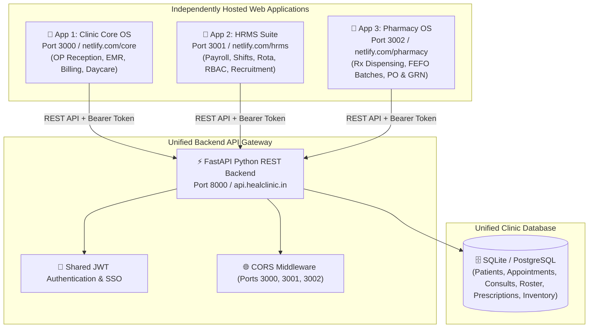

# HEAL Multi-Frontend Architecture Specification

This document details the multi-web application decoupled architecture for the HEAL Clinic Enterprise System. The system decouples the previously monolithic interface into **three specialized, independently deployable web application frontends**, all powered by a **single unified Python FastAPI backend**.

---

## 1. High-Level Architecture



---

## 2. Decoupled Web Applications Breakdown

### 🏥 1. HEAL Clinic Core Frontend (`/Frontend`)
* **Target Port:** `3000` (Dev: `npm run dev -- --port 3000` / Production: Netlify Primary)
* **Target Audience:** Receptionists, Outpatient Coordinators, Consulting Doctors, Clinic Directors, Cashiers.
* **Scope & Modules:**
  * **Reception & Outpatients:** Search-First OP Registration, Live Token Queue, Doctor Slot Calendar, Follow-Up Review Queue.
  * **Clinical EMR Core:** Doctor EMR Workbench with Doctor-Patient Isolation (consultation notes, vitals, diagnosis, Rx generation).
  * **Aesthetic Care & Vault:** Package management, multi-session deduction ledgers, Before/After clinical photo vault.
  * **Daycare & Minor Procedures:** Daycare bed & procedure recliner map, real-time occupancy.
  * **Point of Sale & Billing:** Unified OP billing terminal, customer AR ledger, cashier shifts.
  * **Reports & Forensic Audit:** Executive KPI dashboard, cashier collection audit, GST sales summary, forensic audit trail.
  * **Master Data Catalogs:** Patient directory with unified master sync.
* **Universal Portal Switcher:** Includes `AppSwitcher` in header and sidebar to quickly jump to HRMS or Pharmacy.

---

### 👥 2. HEAL HRMS & Workforce Suite (`/Frontend-HRMS`)
* **Target Port:** `3001` (Dev: `npm run dev -- --port 3001` / Production: Netlify HRMS)
* **Target Audience:** HR Executives, Branch Administrators, Clinic Directors, Operations Managers.
* **Scope & Modules:**
  * **HR Dashboard Overview:** Headcount stats, live branch clock-ins, leave requests, upcoming appraisals.
  * **Organization & Multi-Branch:** Hierarchical branch management (Karanthoor, Beach Road, Sulthan Bathery).
  * **Staff Directory & Profiles:** Employee files, medical degrees, council registration numbers, contract types.
  * **Attendance & Live Punch:** Biometric & shift clock-in monitoring.
  * **Shifts & Doctor Rota:** Doctor shift scheduling and branch coverage.
  * **Leave Coverage Tracker:** Leave applications, approvals, and locum duty reassignment.
  * **Payroll & Commissions:** Monthly payroll generation, allowances, deductions, and doctor procedure commission calculator.
  * **Medical Board Compliance:** TCMC medical council registration tracking and renewal alerts.
  * **Recruitment & Job Pipeline:** Candidate tracking, interview scheduling, offer letters.
  * **Workforce Analytics:** Departmental overheads, staff turnover, overtime analytics.
  * **Employee Self-Service (ESS):** Payslip downloads, leave requests, profile updates.
  * **Doctor Profiles & RBAC Master:** Access control definitions, password management, and permission toggles.

---

### 💊 3. HEAL Pharmacy & Dispensary OS (`/Frontend-Pharmacy`)
* **Target Port:** `3002` (Dev: `npm run dev -- --port 3002` / Production: Netlify Pharmacy)
* **Target Audience:** Chief Pharmacists, Dispensary Nurses, Procurement & Inventory Officers.
* **Scope & Modules:**
  * **Rx Dispensing Terminal:** Real-time prescription queue automatically fed by Doctor Consultations from the Core EMR.
  * **FEFO Batches & Expiry Tracker:** First-Expired, First-Out batch allocation, expiry color alerts (expired, critical <60 days, safe).
  * **Procurement & Consumables:** Purchase Orders (PO), Goods Received Notes (GRN), and 3-way matching.
  * **Inter-Branch Stock Transfers:** Transfer requests and dispatch between Karanthoor HQ, Beach Road, and Wayanad branches.
  * **Medicine & Formulary Master:** Drug catalogs, dosage forms, chemical compositions, stock reorder thresholds.
  * **Vendor & Supplier Directory:** Pharmaceutical distributor profiles, payment terms, contact persons.
  * **Dispensary Stock Ledger:** Live stock auditing and stock reconciliation logs.

---

## 3. Unified Backend API Architecture (`/Backend-python`)

The FastAPI backend runs on **Port 8000** and serves all three frontends seamlessly.

### Domain Endpoint Mapping Table

| Domain / Module | Router File | Primary Endpoints | Consuming Frontend(s) |
| :--- | :--- | :--- | :--- |
| **Authentication & SSO** | `routers/auth.py` | `/api/auth/login`, `/api/auth/me`, `/api/auth/refresh` | **All 3 Frontends** |
| **Patients Master** | `routers/patients.py` | `/api/patients`, `/api/patients/search`, `/api/patients/{id}` | **Core**, **Pharmacy** |
| **Appointments & Queue** | `routers/appointments.py` | `/api/appointments`, `/api/appointments/followups` | **Core** |
| **Clinical Consultations** | `routers/consultations.py` | `/api/consultations`, `/api/consultations/{id}` | **Core** |
| **Prescriptions** | `routers/prescriptions.py` | `/api/prescriptions`, `/api/prescriptions/pdf` | **Core**, **Pharmacy** |
| **Medicines & Batches** | `routers/medicines.py` | `/api/medicines`, `/api/medicines/batches` | **Core**, **Pharmacy** |
| **Billing & Payments** | `routers/billing.py` | `/api/billing`, `/api/payments`, `/api/shifts` | **Core** |
| **Aesthetic Packages** | `routers/packages.py` | `/api/packages`, `/api/sessions` | **Core** |
| **HRMS & Payroll** | `routers/hrms.py` | `/api/hrms/roster`, `/api/hrms/commissions` | **HRMS** |
| **Staff & Doctors** | `routers/staff.py` | `/api/staff`, `/api/staff/{id}` | **HRMS**, **Core** |
| **Departments** | `routers/departments.py` | `/api/departments` | **All 3 Frontends** |
| **Inventory & Procurement** | `routers/inventory.py` | `/api/inventory/pos`, `/api/inventory/transfers` | **Pharmacy** |
| **Executive Reports** | `routers/reports.py` | `/api/reports/kpi`, `/api/reports/audit-trail` | **Core**, **HRMS** |

---

## 4. Single Sign-On (SSO) & Cross-Portal Navigation

* **Shared Storage / JWT:** When a user logs in on any portal, the JWT token (`heal-auth` stored in localStorage / session) carries their role and identity.
* **Universal App Switcher (`AppSwitcher.tsx`):** Available in the top header and sidebar across all three frontends. Users can switch between apps in 1 click without losing their active branch context.
* **Branch Isolation Sync:** The active branch selector synchronizes across tabs via the `BroadcastChannel('HEAL_SYNC_CHANNEL')`, ensuring consistent multi-branch switching across all 3 frontends.

---

## 5. How to Run Locally

To boot up the complete 4-tier system (3 frontends + 1 backend) at once, run:

```bat
d:\HEAL\FINAL\start_all_portals.bat
```

Or run each service individually in separate terminals:

```powershell
# 1. FastAPI Python Backend (:8000)
cd d:\HEAL\FINAL\Backend-python
python -m uvicorn main:app --host 0.0.0.0 --port 8000 --reload

# 2. Clinic Core Frontend (:3000)
cd d:\HEAL\FINAL\Frontend
npm run dev -- --port 3000

# 3. HRMS & Workforce Frontend (:3001)
cd d:\HEAL\FINAL\Frontend-HRMS
npm run dev -- --port 3001

# 4. Pharmacy & Dispensary Frontend (:3002)
cd d:\HEAL\FINAL\Frontend-Pharmacy
npm run dev -- --port 3002
```
